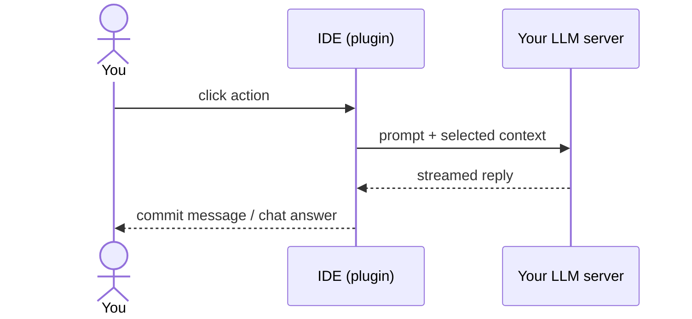

# Local AI Toolset

[](https://github.com/undici77/local-ai-toolset/actions/workflows/build.yml)

<!-- plugin-description -->
Lightweight, privacy-first AI helpers for CLion and any IntelliJ-platform IDE 2025.3+.
Generate commit messages, chat with files and selections as context, and explain commits, all running on your own model
(Ollama, LM Studio, llama.cpp, vLLM, oMLX) or any OpenAI- or Anthropic-compatible endpoint.
No account, no telemetry, no autocomplete, no background traffic: data leaves the IDE only when you click, and only to the server you configured.
Open source (MIT).
<!-- plugin-description-end -->

## TL;DR

Four AI actions you'll actually use, wired to a model you run yourself.
None of the account, cloud backend or always-on features of a full AI suite.

## Why this plugin

JetBrains AI Assistant is a full AI suite. If all you want is a commit message and a chat panel connected to a local model, it's more than you need.

| | JetBrains AI Assistant | Local AI Toolset |
|---|---|---|
| Account / license | JetBrains account + AI plan | None |
| Default backend | JetBrains cloud | Your server (localhost by default) |
| Telemetry | Governed by JetBrains data-collection settings | None, no analytics code at all |
| Always-on features | Inline completion, suggestions, agent | None, nothing runs until you click |
| Scope | Completion, refactoring, agents, tests, docs… | Commit message, chat, ask about selection, explain commit |
| Source | Closed | MIT, small enough to read in an afternoon |

**Verdict:** pick AI Assistant if you want a full AI suite. Pick this plugin if you want a few focused actions, local models and zero background traffic.

## Privacy

| Rule | How it's enforced |
|---|---|
| Sends data only on click | No startup activity, no network calls and no keychain reads before your first action |
| Sends only to your provider | The only outbound HTTP goes to the base URL you configured |
| No telemetry | No analytics, crash reporting or usage tracking in the code |
| Keys never touch disk | API keys live in the IDE password store (PasswordSafe), never in config files |
| Sends only what the action needs | Commit: checked diff + file list + branch + recent commit subjects. Chat: the files and selections you added |
| Auditable | MIT-licensed, all source in `src/main/kotlin` |



## What it does

| Feature | Where | Sends |
|---|---|---|
| Generate commit message | ✨ in the Commit tool window · `Ctrl+Alt+G` · "…with Hint (AI)…" for extra guidance. Click again to stop | Diff of checked changes |
| AI Chat | **AI Chat** tool window (right side) | Your messages + attached context |
| Add to AI Chat | Right-click in the Project view or on an editor tab | Nothing until you send |
| Ask AI about selection | Right-click selected code | Nothing: it pre-fills the chat, you press send |
| Explain commit | Right-click a commit in the Git log | That commit's message + diff |

## Quick start

1. Install the plugin: *Settings → Plugins → ⚙ → Install Plugin from Disk* → `local-ai-toolset-<version>.zip`.
2. Start a local model:
   ```
   ollama serve
   ollama pull qwen2.5-coder:7b
   ```
3. *Settings → Tools → Local AI Toolset* → **Providers**: add Ollama → **Features**: pick it for each feature.
4. Stage some changes and press `Ctrl+Alt+G`.

Until a provider is set, actions show an error with an "Open Settings" link.

## Providers

| Provider | Base URL | Key |
|---|---|---|
| Ollama | `http://localhost:11434/v1` | no |
| oMLX (Apple Silicon) | `http://localhost:8000/v1` | no |
| LM Studio (enable local server) | `http://localhost:1234/v1` | no |
| llama.cpp / mlx_lm.server | `http://localhost:8080/v1` | no |
| vLLM | `http://localhost:8000/v1` | no |
| Generic OpenAI-compatible | any Chat Completions server (also OpenAI, OpenRouter…) | optional |
| Generic Anthropic-compatible | any Messages server (`https://api.anthropic.com`, no `/v1`) | optional |

Cloud endpoints work, but then your data goes to that cloud provider. That choice is yours.

## Per-project config

Each feature can override provider, model, prompts and limits for a project. These files contain no secrets, so they're safe to commit:

```
.ai-toolset/config.json
.ai-toolset/prompts/commit-message.system.md
.ai-toolset/prompts/commit-message.user.md
```

```json
{ "features": { "commit_message": { "provider_id": "ollama", "model": "qwen2.5-coder:7b",
                                     "temperature": 0.2, "max_tokens": 400, "max_context_chars": 30000 } } }
```

| Feature key | Template variables |
|---|---|
| `commit_message` | `{diff} {files} {branch} {recent_commits} {hint}` · conditional `{?hint: … }` |
| `chat` | `{context}` (system prompt) |
| `explain_commit` | `{commit}` |
| `ask_selection` | none (prefill only) |

Unknown keys are ignored.

## Limitations

- Commit messages support Git only.
- A partial commit (some lines unchecked) sends the diff of the whole file.
- Chat history lives in memory only and is lost when the IDE restarts.

## Build

Everything builds in Docker, so you don't need a local JDK:

```
make image wrapper test build verify
```

The output is `build/distributions/local-ai-toolset-<version>.zip`.

## Release

1. Set `pluginVersion` in `gradle.properties` (e.g. `1.1.0`, or `1.1.0-beta.1` for the beta channel).
2. Run `./gradlew patchChangelog` to move `[Unreleased]` under the new version, then commit.
3. Push a tag `v<pluginVersion>`. The `release` workflow tests, signs, creates the GitHub Release
   and publishes to JetBrains Marketplace.

The workflow needs the repo secrets `CERTIFICATE_CHAIN`, `PRIVATE_KEY`, `PRIVATE_KEY_PASSWORD`, `PUBLISH_TOKEN`
and the repo variable `PUBLISH_TO_MARKETPLACE=true` (without it, the Marketplace step is skipped).

## License

MIT, see [LICENSE](LICENSE).
