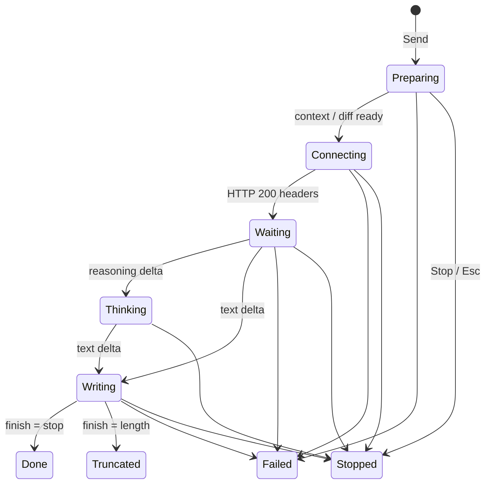

# UX improvement plan

Goal: the user always knows **what the LLM is doing right now**, and the UI shows **no rendering artifacts**.

## 1. What is wrong today

### 1.1 State is not visible

| # | Where | Problem | Code |
|---|---|---|---|
| S1 | Chat | Between *Send* and the first token nothing is shown, only the button turns into *Stop*. A local server loading a model can take 10–60 s, so this looks like a hang. | `ChatService.send`, `ChatPanel.streamDelta` (the bubble is created on the first delta) |
| S2 | Chat | Thinking models stream reasoning in `reasoning_content` / `reasoning`. It is dropped, so the user stares at an empty panel for the whole thinking phase. Anthropic `thinking_delta` is ignored too. | `OpenAiCompatClient.stream`, `AnthropicClient.stream` |
| S3 | Chat | Nothing tells the user when an answer was **cut off** (`finish_reason: length` / `stop_reason: max_tokens`). It looks complete. | both clients ignore finish reason |
| S4 | Chat | A stopped answer looks the same as a finished one. | `ChatService` cancel branch |
| S5 | Chat | No model / time / token info after an answer, so there is no feedback on speed or which model answered. | — |
| S6 | Explain Commit | `git show` runs with no feedback. If the chat is busy, the action silently does nothing. | `ExplainCommitAction.actionPerformed` (`if (svc.isRunning) return`) |
| S7 | Commit message | Only the toolbar icon changes. Until the first token the field just keeps its old text; no progress, no elapsed time. | `CommitMessageService.start` |
| S8 | Chat | The user message does not say which context (files, lines, ~tokens) was sent with it. | `ChatPanel.messageAdded` |

### 1.2 Artifacts

| # | Where | Artifact | Cause |
|---|---|---|---|
| A1 | Chat | While streaming, the answer is plain text with raw ```` ``` ```` fences, `**`, `#`; at the end it **jumps** to rendered Markdown and code blocks (layout reflow, scroll jump). | `MessageView.appendStreaming` uses a `JBTextArea`, `render()` only on `streamEnded` |
| A2 | Chat | `<think>…</think>` emitted **inside** the content (Ollama, llama.cpp, some Qwen/DeepSeek builds) is shown raw. | `OutputCleaner` is used only for commit messages |
| A3 | Chat | Flicker / jitter while streaming: `revalidate()` without `repaint()` on every token, plus one `invokeLater` scroll per token. | `MessageView.appendStreaming`, `ChatPanel.scrollToBottomIf` |
| A4 | Chat | Text not wrapping or clipped on the right when the tool window is resized (to confirm in the IDE). | viewport view is a plain `JPanel`, not `Scrollable` with `getScrollableTracksViewportWidth() = true` |
| A5 | Chat | Markdown gaps: numbered items separated by blank lines all render as **"1."**; tables (`\|---\|`), blockquotes, `---`, nested lists show as raw text. | `MarkdownLite.toHtml` closes the list on every blank line, no table/quote support |
| A6 | Chat | A long HTTP error body (up to 2000 chars of JSON) goes into a **one-line** red `JBLabel` and blows out the layout. | `MessageView.addError`, `streamSse` error body |
| A7 | Chat | *Retry* removes the user bubble but leaves the failed assistant bubble with its error → orphan error above the new attempt. | `ChatPanel.retry` |
| A8 | Chat | *New Chat* while streaming: the cancel handler runs after `cleared()`, appends the partial answer to the **new** history; late deltas can create a stray bubble. | `ChatService.clear` / cancel branch, no run id |
| A9 | Chat | Code blocks: the horizontal scrollbar of `EditorTextField` covers the last line. | `MessageView.codeBlock` |
| A10 | Commit | The commit field is filled with the **raw** stream (`<think>`, ```` ``` ````, `Commit message:` label), then jumps to the cleaned text at the end. | `CommitMessageService.start` streams `acc`, cleans only at the end |

## 2. Target design

### 2.1 One run-state model, shared by all features



| State | Chat shows | Commit shows |
|---|---|---|
| Preparing | spinner · "Reading 3 files…" / "Reading commit a1b2c3…" | background progress "Collecting diff…" |
| Connecting | spinner · "Connecting to *LM Studio*…" | "Connecting to *LM Studio*…" |
| Waiting | spinner · "Waiting for *qwen3* · 12 s (loading model or reading prompt)" | same text + elapsed |
| Thinking | spinner · "Thinking… 8 s" + collapsed **Reasoning** section | "Thinking… 8 s" |
| Writing | answer rendered live, small "Writing…" | cleaned text grows in the field |
| Done | footer: `qwen3 · 4.2 s · 312 tok · 38 tok/s` | progress closes |
| Truncated | warning "Cut off: max output tokens reached" + **Continue** link | balloon with the same text |
| Stopped | footer "Stopped" | partial (cleaned) text kept |
| Failed | short error + **Retry** + **Details** + **Open Settings** (config/connection errors) | balloon (as today) |

### 2.2 Stream events instead of raw text deltas

Change `LlmClient.stream(req, onDelta)` to `stream(req, onEvent: suspend (StreamEvent) -> Unit)`:

| Event | OpenAI-compatible | Anthropic |
|---|---|---|
| `Connected` | HTTP 2xx received | HTTP 2xx received |
| `Reasoning(text)` | `delta.reasoning_content` / `delta.reasoning` | `thinking_delta` |
| `Text(text)` | `delta.content` | `text_delta` |
| `Finished(reason, usage?)` | `finish_reason`, `usage` (send `stream_options.include_usage`, ignore if unsupported) | `message_delta.stop_reason`, `usage` |

A streaming `ThinkTagFilter` sits after the client: it moves `<think>…</think>` found in `Text` into `Reasoning` and **handles tags split across deltas**. It replaces the regex in `OutputCleaner` for both chat and commit.

## 3. Work plan

| Step | Change | Fixes | Files |
|---|---|---|---|
| 1 | `StreamEvent` + finish reason / usage / reasoning in both clients; `ThinkTagFilter` (streaming-safe). | S2, S3, A2 | `llm/*`, `prompt/OutputCleaner.kt` |
| 2 | `RunState` in `ChatService`; every run gets a **run id**, listener events carry it, the panel drops events from an old run. `clear()` waits for nothing and ignores late events. | S1, S4, A8 | `ChatService.kt` |
| 3 | Assistant bubble is created **on Send** with a status row (`AnimatedIcon.Default` + label, 1 s timer for elapsed time). Footer with model/time/tokens; Truncated warning + Continue; Stopped label. | S1–S5 | `ChatPanel.kt`, `MessageView.kt` |
| 4 | Incremental Markdown while streaming: closed paragraphs/code fences are rendered once and kept; only the open tail is re-rendered. UI updates coalesced to ~20 fps (one `Alarm`/`Timer` tick does append + revalidate + repaint + scroll). | A1, A3 | `MessageView.kt`, `MarkdownLite.kt` |
| 5 | Layout: viewport view implements `Scrollable` (track viewport width); code block editor reserves room for its scrollbar (or soft-wraps). | A4, A9 | `ChatPanel.kt`, `MessageView.kt` |
| 6 | Markdown coverage: keep list numbers across blank lines (`<ol start=N>`), tables, blockquote, `---`, nested lists, heading sizes. **Decision:** extend `MarkdownLite`, or use the platform Markdown → HTML converter (check it is available in 2025.3 without a plugin dependency). | A5 | `MarkdownLite.kt` |
| 7 | Errors: wrapped text, first line only + **Details** expander; extract `error.message` from JSON bodies; **Open Settings** link for config/connection errors; Retry replaces the failed bubble. | A6, A7 | `MessageView.kt`, `ChatPanel.kt`, `SseReader.kt` |
| 8 | Context summary under each user bubble ("3 files · ~2.1k tokens"); model combo disabled while running. | S8 | `ChatPanel.kt` |
| 9 | Explain Commit: Preparing state in chat; if chat is busy, ask "Stop current answer and explain?" instead of silently returning. | S6 | `ExplainCommitAction.kt` |
| 10 | Commit message: `withBackgroundProgress(project, …, cancellable)` with the run-state text (status bar, cancel button); field receives the **filtered/cleaned** text while streaming. | S7, A10 | `CommitMessageService.kt` |
| 11 | Tests + manual checks (below). | — | `src/test/...` |

Steps 1–2 are the foundation; 3–5 give most of the visible gain; 6–10 are independent and can go in any order.

## 4. Verification

| Kind | Check |
|---|---|
| Unit | `ThinkTagFilter`: tag split at every byte position, nested/unclosed tag, no tag. |
| Unit | Client parsing: finish reason, usage, reasoning for both APIs (extend `ClientsHttpTest`). |
| Unit | `MarkdownLite`: `1.`/blank/`2.` keeps numbers; table; blockquote; incremental render = final render. |
| Unit | `ChatService`: clear while running leaves history empty; late events ignored. |
| IDE | Cold local model (unloaded): Waiting state with timer visible within 100 ms of Send. |
| IDE | Thinking model: Thinking state, reasoning collapsed, answer separate. |
| IDE | `max_tokens = 50`: Truncated warning + Continue works. |
| IDE | Resize tool window during streaming: no clipping, no flicker, scroll sticks to bottom only when already at bottom. |
| IDE | Server down: short error, Details, Open Settings, Retry replaces the bubble. |
| IDE | Commit message with a thinking model: field never shows `<think>`; status bar progress with cancel. |

## 5. Decisions for the user

| Question | Options | Recommendation |
|---|---|---|
| Show reasoning text? | (a) collapsed section with full text, (b) only "Thinking… N s" | (a), collapsed by default |
| Markdown renderer | (a) extend `MarkdownLite`, (b) platform converter | (a): the public platform converter (`DocMarkdownToHtmlConverter`) is meant for Quick Documentation and needs a `Project`; the general one is `@ApiStatus.Internal` |
| Stats footer | always / on hover only | always, small grey text |
